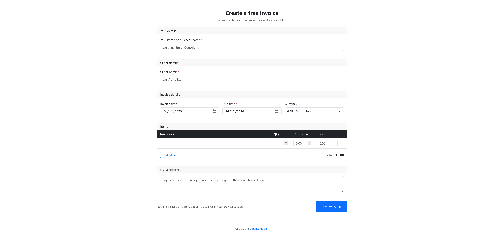
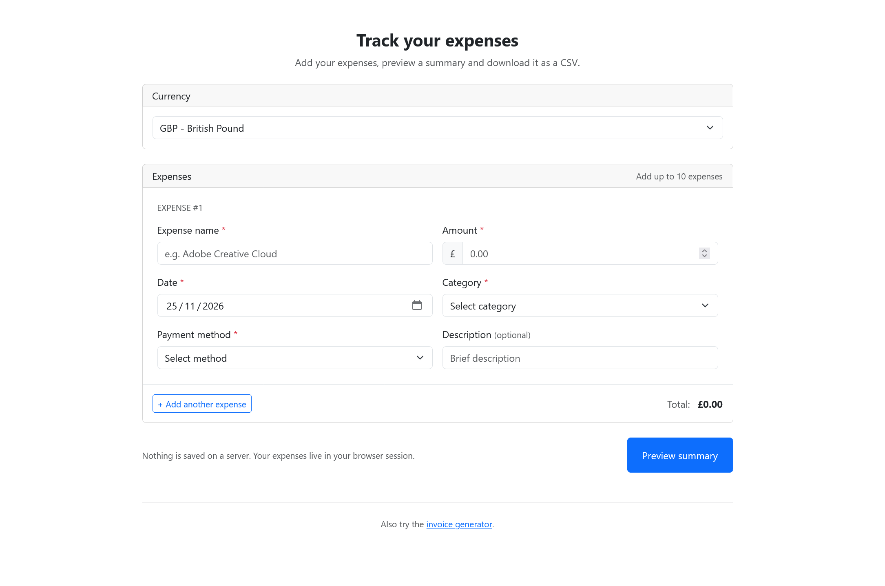

# Invoice and Expense Tools


Two small tools for UK freelancers and sole traders, built with plain Laravel and Blade. There is no database and no accounts. Everything lives in your browser session.


## What it does

**Invoice generator**
- Create an invoice with up to 20 line items
- Choose from GBP, USD or EUR
- Preview it, edit it, then download it as a PDF



**Expense tracker**
- Log up to 10 expenses with a category, payment method and date
- See totals by category
- Download an accountant-friendly CSV that includes the UK tax year (6 April to 5 April) for each expense



## Requirements

- PHP 8.2 or higher
- Composer
- Node.js and npm (the PDF download uses Puppeteer and Chromium)

## Quick start

```bash
git clone https://github.com/iamjoshade/invoice-expense-tools.git
cd invoice-expense-tools
composer install
npm install
cp .env.example .env
php artisan key:generate
php artisan serve
```

Then open http://localhost:8000.

## How it works

- Data is kept in the session, so nothing is saved on a server and closing the browser clears it.
- Totals, tax year logic and CSV building live in small service classes (`InvoiceService`, `ExpenseSummaryService`), which keeps the controllers thin and the logic easy to test.
- PDFs are rendered by [Spatie Browsershot](https://github.com/spatie/browsershot) behind an `InvoicePdfService`, so tests can mock it.
- User input is escaped everywhere, JavaScript is disabled in the PDF renderer, and CSV cells that start with `=`, `+`, `-` or `@` are neutralised so they can't run as spreadsheet formulas.

## Running the tests

```bash
php artisan test
```

The tests need no database and no Chrome. The PDF service is mocked.

## Troubleshooting

If the PDF download fails, check `storage/logs/laravel.log` first. The usual causes are:

- Node is not installed or not on your PATH. Run `node -v` to check.
- You skipped `npm install`, so Puppeteer and Chromium are missing.

## Licence

MIT. See [LICENSE](LICENSE).
